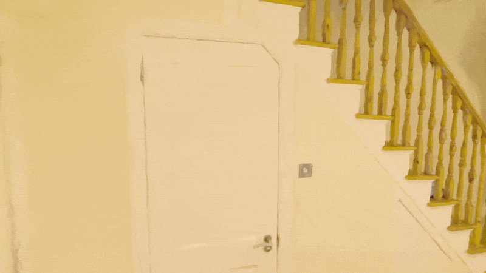
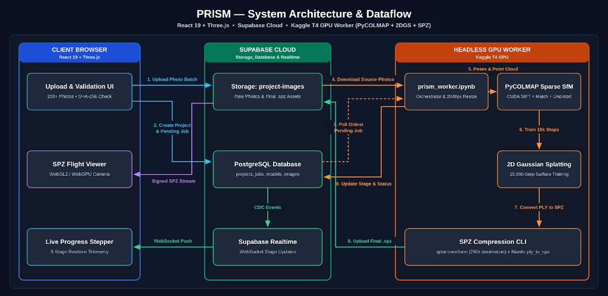
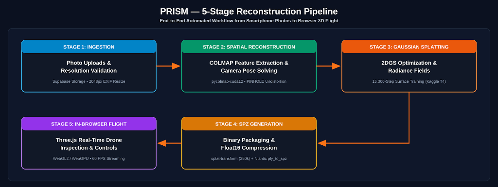

# PRISM - 3D Gaussian Splat Photogrammetry & SPZ Flight Viewer

[](https://react.dev/)
[](https://www.typescriptlang.org/)
[](https://threejs.org/)
[](https://supabase.com/)
[](https://developer.nvidia.com/cuda-toolkit)
[](https://vitejs.dev/)

PRISM is an end-to-end browser-based 3D photogrammetry and spatial computing platform. It bridges the gap between raw physical photography and interactive, real-time 3D Gaussian Splatting (`.spz`). By orchestrating headless cloud GPU workers with Supabase Realtime, PRISM turns sets of unposed 2D photographs into navigable, photorealistic 3D digital twins that can be explored in real time directly in the browser with no plugins required.

<p align="center">
  
</p>

---

## 🌟 Key Features & Engineering Highlights

- **Client-Side Pre-Flight Validation**: Automatic real-time validation of uploaded photo batches (image count checks, minimum resolution, camera motion coverage) before committing to cloud GPU jobs.
- **Distributed Cloud GPU Worker**: Decoupled, serverless architecture where a headless Kaggle T4 GPU worker continuously polls Supabase for pending jobs, processes Structure-from-Motion (SfM) and Gaussian Splatting, and delivers the binary artifacts.
- **2D Gaussian Splatting (2DGS)**: Leverages 2D surface-aligned Gaussian splats for geometrically consistent planar surfaces, sharp indoor edges, and superior view synthesis compared to traditional 3DGS.
- **High-Density Compression (.spz)**: Automatically compresses heavy 250MB+ Gaussian point cloud `.ply` files into highly optimized `.spz` binary archives (~15–20MB), slashing network latency by over 90%.
- **Live WebSocket Pipeline Synchronization**: Subscribes to Supabase Realtime WebSocket changes to stream live 5-stage reconstruction status updates directly to the UI stepper.
- **Native Real-Time In-Browser Flight Viewer**: Built directly in Three.js and WebGPU/WebGL2 featuring free-flight drone camera mechanics (WASD navigation, Q/E altitude, Shift boost, Alt inertia damping).
- **SuperSplat Color Fidelity Calibration**: Fine-tuned `LinearSRGBColorSpace` rendering and `NoToneMapping` pass to prevent double-gamma curve compounding, perfectly matching SuperSplat color grading and contrast.

---

## 🏗️ Architecture Overview

<p align="center">
  
</p>

---

## 🔄 End-to-End Reconstruction Lifecycle

<p align="center">
  
</p>

1. **Stage 1 (Ingestion & Pre-Flight)**: Photos are ingested via drag-and-drop, validated for focal consistency and count thresholds (100+ recommended), and uploaded to Supabase Storage.
2. **Stage 2 (Spatial Reconstruction)**: PyCOLMAP performs SIFT feature extraction, exhaustive two-view matching, and incremental Structure-from-Motion (SfM) to solve camera intrinsics and extrinsics.
3. **Stage 3 (Gaussian Splatting)**: 2D Gaussian Splatting trains against the COLMAP sparse point cloud, optimizing 2D oriented surfels, spherical harmonics, and opacity values over thousands of iterations.
4. **Stage 4 (SPZ Generation)**: The trained `.ply` checkpoint is compressed using the `spz` CLI into a compact binary format and uploaded to the `project-images` bucket.
5. **Stage 5 (Model Preparation & Flight)**: The client automatically loads the `.spz` model into the Three.js viewport with free-look drone navigation and live splat metrics.

---

## 📸 Photo Capture Guidelines (Before Training)

To prevent COLMAP Structure-from-Motion (SfM) registration failures and ensure crisp indoor reconstructions:

- **Target Photo Count**: Capture **150–250 images** for a standard room. Fewer than 90 images frequently leads to unlinked camera clusters or blind spots.
- **Overlap**: Maintain **60–70% visual overlap** between consecutive shots. Take smooth, overlapping steps rather than standing in the center and pivoting.
- **Lighting**: Keep lighting uniform. Avoid switching lamps on or off mid-capture, and shoot with curtains closed if bright sunlight is casting moving, high-contrast shadows.
- **Featureless Walls**: COLMAP SIFT feature matching relies on texture. Avoid photographing large, blank white walls in isolation—ensure every frame catches reference objects (door frames, baseboards, light switches, furniture, or wall art).
- **Automated Resizing**: You do not need to manually downscale your photos. The worker notebook automatically resizes high-res 4K smartphone photos to **2048px** on the longest edge while strictly preserving EXIF orientation metadata (`ImageOps.exif_transpose`), keeping GPU memory usage safely within Kaggle T4's 16GB VRAM limit.

---

## 💻 Tech Stack

- **Frontend**: React 19, TypeScript, Vite, Tailwind CSS, Lucide Icons
- **3D Graphics & Engine**: Three.js, `@sparkjsdev/spark`, WebGL2 / WebGPU
- **Backend & Database**: Supabase (PostgreSQL, Storage, Realtime, Row Level Security)
- **Computer Vision & ML**: PyCOLMAP (CUDA 12), 2D Gaussian Splatting (PyTorch), `spz` binary format, `@playcanvas/splat-transform`

---

## 📂 Repository Structure

```text
PRISM/
├── docs/images/            # High-resolution architectural diagrams and demo preview
├── src/
│   ├── components/         # React UI, Live Progress Stepper & Three.js SpzViewer
│   ├── lib/                # Supabase Realtime client & SPZ blob streaming
│   └── types/              # TypeScript schema definitions
├── supabase/
│   └── schema.sql          # Database tables, RLS policies & Storage bucket setup
├── worker/
│   └── prism_worker.ipynb  # Kaggle T4 GPU notebook (COLMAP + 2DGS + SPZ)
├── public/                 # Static fallback models and media assets
├── package.json
└── README.md
```

---

## ⚡ Quick Start

> [!TIP]
> **Instant Standalone 3D Demo**: You can explore the 3D Gaussian Splat flight viewer immediately without setting up Supabase or logging in by opening `/demo` (or `?demo=true`). It automatically streams `/DemoModelling.spz` fullscreen with full drone flight camera controls.

### 1. Clone & Install
```bash
git clone https://github.com/<your-username>/<your-repo-name>.git
cd <your-repo-name>
npm install
```

### 2. Configure Environment
```bash
cp .env.example .env.local
```
Set your credentials in `.env.local`:
```env
VITE_SUPABASE_URL=https://your-project-id.supabase.co
VITE_SUPABASE_PUBLISHABLE_KEY=your-supabase-publishable-key
```

### 3. Run Locally
```bash
npm run dev
```
Open [http://localhost:3000](http://localhost:3000).

---

## 🗄️ Supabase Setup

1. Open your Supabase project dashboard and navigate to the **SQL Editor**.
2. Run the SQL script located at [`supabase/schema.sql`](supabase/schema.sql). This will:
   - Create all required tables (`projects`, `sessions`, `uploaded_images`, `reconstruction_jobs`, `reconstructed_models`).
   - Create and configure the `project-images` Storage bucket.
   - Enable Supabase Realtime publication on `reconstruction_jobs`.
   - Apply Row Level Security (RLS) policies.
3. Verify under **Storage** that the `project-images` bucket is created and set to public.

---

## 🚀 Kaggle GPU Worker (Reconstruction Pipeline)

The background reconstruction worker processes pending jobs using COLMAP and 2D Gaussian Splatting:

1. Go to [Kaggle](https://www.kaggle.com/) and create a new notebook (**File -> Import Notebook -> Upload `worker/prism_worker.ipynb`**).
2. In the right-hand **Notebook settings**:
   - Set **Accelerator** to **GPU T4** (or **GPU T4 x2**).
   - Turn **Internet** toggle to **ON**.
3. In Kaggle top menu, go to **Add-ons -> Secrets** and add:
   - `SUPABASE_URL`: Your Supabase Project URL.
   - `SUPABASE_SERVICE_ROLE_KEY`: Your Supabase secret `service_role` key (Settings -> API).
4. Run the notebook:
   - **Cell 1**: Installs `pycolmap-cuda12`, clones `2d-gaussian-splatting`, builds `spz` CLI, and installs `@playcanvas/splat-transform`.
   - **Cell 2**: Polls Supabase for the oldest `pending` job, downloads photographs, runs COLMAP sparse reconstruction, trains 2DGS, converts to `.spz`, and updates status to `completed`.

> [!TIP]
> **Headless 12-Hour Cloud Execution**: To run the worker continuously without keeping your browser open, select **"Save Version" → "Save & Run All (Commit)"** in Kaggle. The notebook runs in an independent background VM on Kaggle servers for up to 12 hours. Wrap the job processor in a `while True:` polling loop with `time.sleep(15)` and `shutil.rmtree()` workspace cleanup to process batches indefinitely.

---

## ⚙️ Training Configuration & Tuning (Inside Kaggle)

The background worker in [`worker/prism_worker.ipynb`](worker/prism_worker.ipynb) exposes several key hyperparameters and compatibility patches:

1. **`STEPS = 15000` (Iteration Tuning)**:
   - Default 3DGS configurations often terminate at 7,000 steps. While 7k steps is sufficient for isolated foreground objects, complex indoor scenes still contain blurry, cloud-like artifacts on walls and floors at this stage.
   - Pushing 2DGS to **15,000 steps** forces Gaussian surfels to densify along planar surfaces, resolving sharp baseboards, straight wall intersections, and crisp lighting gradients.

2. **`scale_2 = -20.0` (2DGS PLY Compatibility Patch)**:
   - 2D Gaussian Splatting represents surfels using only 2 scale axes (`scale_0`, `scale_1`) along the local surface plane. Standard 3DGS tools—including Niantic's `ply_to_spz`—require a 3D bounding box with 3 scale properties (`scale_0`, `scale_1`, `scale_2`).
   - The worker patches the generated `.ply` by injecting a synthetic `scale_2` column set to `-20.0` (in log space, $e^{-20} \approx 0$). This defines an infinitely flat pancake splat that conforms to the 2DGS mathematical formulation while satisfying the binary parser.

3. **Splat Budget Decimation (`splat-transform -g cpu ...`)**:
   - High-iteration models often generate 800,000+ splats, which can cause frame drops and memory spikes on mobile devices or integrated GPUs.
   - The worker runs `@playcanvas/splat-transform` (`-g cpu input.ply --filter-nan -d 250000 --ply-logit-opacity output.ply -w`) to decimate redundant splats down to a reliable 250k budget.
   - Passing `-g cpu` bypasses missing headless Vulkan/WebGPU drivers in Kaggle's container, and `--ply-logit-opacity` correctly converts the logit-space opacities produced by 2DGS.

---

## 📊 Sample Benchmark Results

Representative metrics from a real indoor room reconstruction run:

| Metric / Parameter | Real Run Value |
| :--- | :--- |
| **Source Photos Ingested** | **241 images** (4K smartphone photos) |
| **COLMAP Camera Registration** | **241 / 241 cameras registered (100%)** |
| **Sparse Point Cloud Density** | **51,846 3D points** (1.02px mean reprojection error) |
| **Optimization Time (15,000 steps)** | **~57 minutes** (on free-tier Kaggle Nvidia T4 GPU) |
| **Raw Point Cloud Size (.ply)** | **265.4 MB** (uncompressed) |
| **Final Web Asset Footprint (.spz)**| **18.4 MB** (**>93% compression**) |
| **Viewer Performance** | **Real-time fluid flight** (capped at 250k splats, WebGL2 / WebGPU) |

---

## 🔧 Troubleshooting (3 Common Pitfalls)

#### 1. Resetting a Stuck or Failed Job in Supabase
If a Kaggle session disconnects due to session timeouts or an unexpected crash, the job in Supabase may remain locked in `colmap` or `training`. Reset it back to `pending` in the Supabase **SQL Editor**:
```sql
UPDATE reconstruction_jobs 
SET status = 'pending', 
    stage = NULL, 
    started_at = NULL 
WHERE status = 'failed' OR stage IN ('colmap', 'training');
```

#### 2. Headless GPU Driver Errors in `splat-transform`
Kaggle's environment lacks physical display servers and WebGPU/Vulkan driver bindings. If `splat-transform` throws driver initialization errors, always force CPU processing:
```bash
splat-transform -g cpu input.ply --filter-nan -d 250000 --ply-logit-opacity output.ply -w
```

#### 3. COLMAP Camera Model Incompatibility (`PINHOLE`)
Mobile devices capture with complex lens distortion (`SIMPLE_RADIAL` or `OPENCV`). 2D Gaussian Splatting requires planar pinhole cameras. The worker automatically runs COLMAP's undistorter to convert cameras into the `PINHOLE` model before training begins:
```bash
colmap image_undistorter \
  --image_path images/ \
  --input_path sparse/0 \
  --output_path undistorted/ \
  --output_type COLMAP
```

---

## 🎮 3D Viewer Controls

When exploring reconstructed spaces in the SPZ Flight Viewer:

| Control | Action |
| :--- | :--- |
| **Mouse Click + Drag** | Look around (yaw & pitch) |
| **W / S** | Move forward / backward |
| **A / D** | Steer left / right |
| **Q / E** | Altitude down / up (height control) |
| **Shift** | Boost flight speed |
| **Alt** | Toggle smooth flight damping mode |

---

## 📚 Research & References

- **2D Gaussian Splatting**: Huang et al., *2D Gaussian Splatting for Geometrically Accurate Radiance Fields* (SIGGRAPH 2024). [Paper](https://surfsplat.github.io/)
- **3D Gaussian Splatting**: Kerbl et al., *3D Gaussian Splatting for Real-Time Radiance Field Rendering* (SIGGRAPH 2023). [Paper](https://repo-sam.inria.fr/fungraph/3d-gaussian-splatting/)
- **Structure-from-Motion**: Schönberger & Frahm, *Structure-from-Motion Revisited* (CVPR 2016). [COLMAP](https://colmap.github.io/)
- **SPZ Compressed Splat Format**: Niantic Labs open binary format and compression tools. [Repo](https://github.com/nianticlabs/spz)
- **Spark WebGL/WebGPU Splat Renderer**: [`@sparkjsdev/spark`](https://github.com/sparkjsdev/spark)

---

## 📄 License

This project is open-source and available under the [MIT License](LICENSE).
